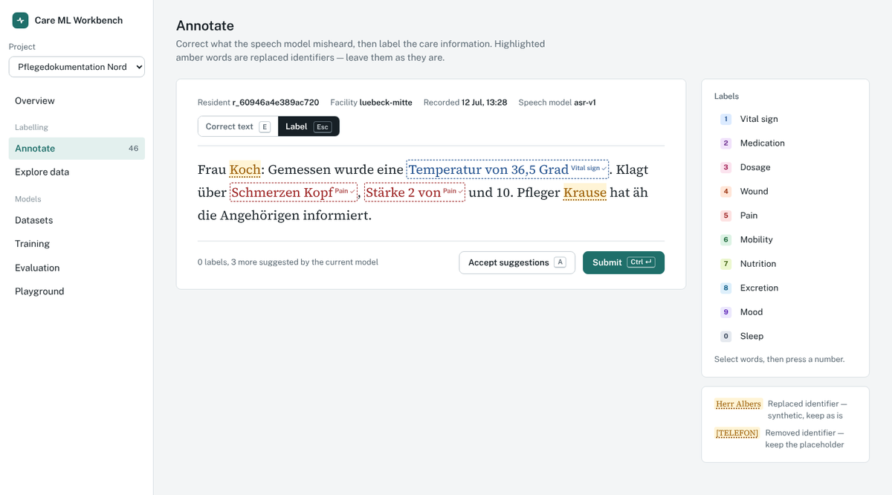
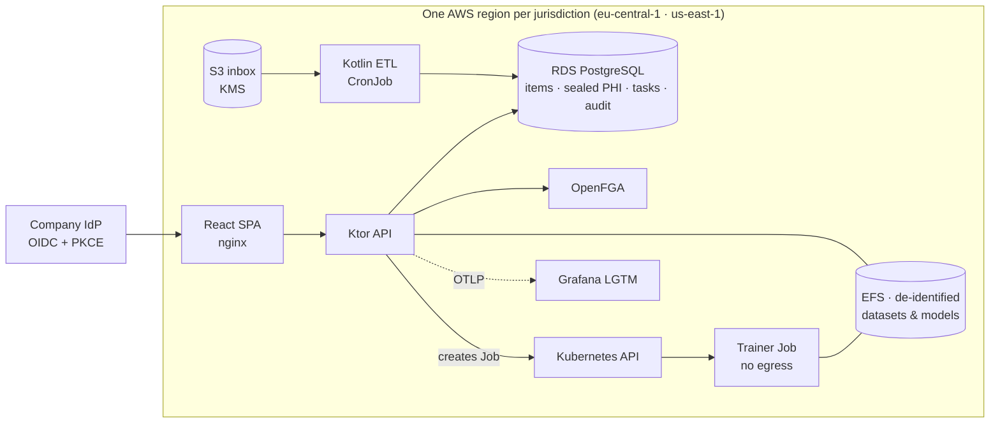
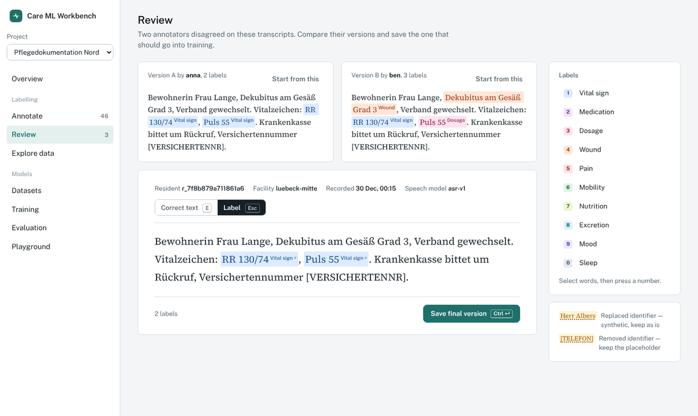
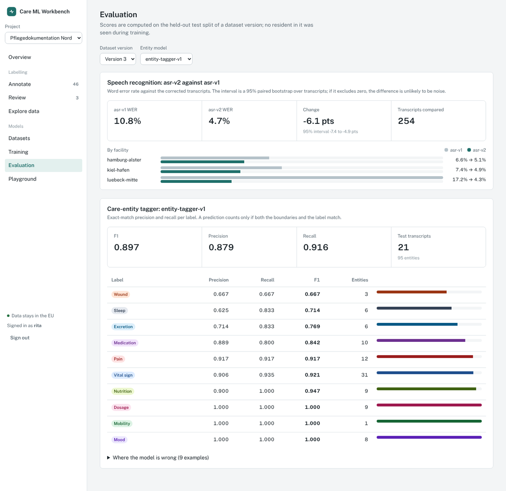

# Care ML Workbench

An internal ML app for a speech-documentation product in elderly care. Nurses dictate care notes; a
speech model transcribes them; a tagger pulls out structured care information (vital signs,
medication, wounds, pain…). This workbench is where the ML team and clinical annotators turn
de-identified transcripts into training data, train and compare models, and try them — without
ever putting protected health information (PHI) at risk.

It covers the whole loop: **HIPAA/GDPR ingest → de-identification → labelling → review →
versioned datasets → training on Kubernetes → evaluation → playground**, with fine-grained
authorisation, a tamper-evident audit log, and per-region data residency.



All data in this repository is synthetic. No real person's information is used anywhere.

## What it does

| Area | What happens |
|---|---|
| **Ingest** (Kotlin ETL) | Validates customer exports, rejects tenants in the wrong region (US data needs a signed BAA), detects PHI (names from the record and from context, birth dates, insurance numbers, phone, e-mail, address, room, ages ≥ 90), replaces it with consistent surrogates and per-resident date shifts, checks for leaks, seals the original with AES-256-GCM envelope encryption, queues tasks and writes an audit event. |
| **Annotate** | Correct the transcript, then select words and press 1–0 to label. Replaced identifiers stay highlighted even while typing. Labels follow their words through edits. The current model's predictions appear as dashed suggestions (`A` accepts them). The server refuses any submission that puts PHI back. |
| **Review** | 15% of transcripts are annotated twice. Disagreements go to a reviewer, who compares both versions side by side and saves the one that goes into training. |
| **Explore** | Filter by status, facility, label or text. People with an explicit `phi_viewer` grant can view the original record after giving a reason; every view is audited. |
| **Datasets** | Frozen, versioned snapshots with a SHA-256 manifest. Residents are split into train/dev/test by pseudonym, so nobody appears in two splits. |
| **Training** | Starts an isolated Kubernetes Job (no network, read-only root, non-root, 1 h deadline). Metrics come back through the termination message; the result is registered as a new model version. |
| **Evaluation** | Speech models compared by WER with a 95% paired bootstrap interval and per-facility slices; the tagger scored per label with exact-match precision/recall and its errors shown. |
| **Playground** | Try a model on your own sentence. Text that looks like PHI is refused before it reaches the model. |
| **Audit log** | Hash-chained events (ingest, PHI views, grants, datasets, training), verified on every read. PostgreSQL rejects updates and deletes. |

## Architecture



- **`backend/core`** — the domain, framework-free Kotlin: PHI detection and de-identification,
  vault, audit chain, authorisation model, annotation rules and agreement, datasets, evaluation,
  the tagger's inference, training state machine, Kubernetes runner, stores (in-memory and
  PostgreSQL).
- **`backend/api`** — Ktor 3: JWT auth against the IdP's JWKS (a dev-only HS256 token endpoint is
  refused in production), OpenFGA checks, status pages that never echo PHI, call IDs, JSON logs
  without bodies, Prometheus metrics, OpenTelemetry agent in the image.
- **`backend/etl`** — the ingest CLI that runs as a CronJob.
- **`trainer`** — Python: hashed features + multinomial logistic regression, exported as base64
  float32 and served from Kotlin. A parity fixture proves both sides compute identical features
  and predictions.
- **`frontend`** — React 19 + TypeScript, TanStack Query, React Router. Self-hosted fonts (no
  requests to Google from a health-data app), strict CSP.
- **`fga/model.fga`** — the authorisation model. Admins inherit reviewer and annotator rights;
  `phi_viewer` is an explicit grant *and* requires tenant membership — admins do not get PHI
  implicitly.
- **`deploy/`** — Kustomize (EU/US overlays), Terraform (EKS, RDS, KMS, EFS, S3, IRSA), and the
  compose stack's Grafana dashboard and alert rules.

## Measured on the demo data

The demo seed generates 900 synthetic records for three tenants, then a simulated annotation team
works through the north project. Numbers below are from that run and from CI.

| | |
|---|---|
| Ingest | 600 records accepted, 300 quarantined (US tenant without BAA), 2,437 PHI spans replaced, 0 leaks after de-identification |
| Annotator agreement (34 double-annotated) | entity F1 0.84 exact / 0.88 overlap, token Cohen's κ 0.87 |
| Speech models (255 reviewed transcripts) | WER 10.8% → 4.5%, difference −6.3 pts, 95% CI −7.5 to −5.1; the weakest facility improves most (17.4% → 3.8%) |
| Entity tagger (test split: 21 transcripts, 95 entities) | F1 0.897, precision 0.879, recall 0.916; trains in under 2 s |
| Tests | 30 core + 9 API/integration (PostgreSQL and OpenFGA via Testcontainers; 98 authorisation checks agree between the local evaluator and the real OpenFGA server), 4 trainer, 12 frontend unit/component, 5 end-to-end in a browser against the real API |

<p>


</p>

## Run it

```bash
docker compose up --build
# web      http://localhost:8081   (pick a demo person: anna annotates, rita reviews, dora may view PHI, olivia administers)
# Grafana  http://localhost:3000   (dashboard "Care ML Workbench — service", alert rules provisioned)
```

Without Docker:

```bash
cd backend && gradle :api:run   # with DEV_AUTH=true SEED_DEMO=true TRAINER_MODE=local
cd frontend && npm ci && npm run dev
```

Tests: `gradle build` in `backend/` (needs Docker for Testcontainers), `pytest trainer/tests`,
`npm test` and `npx playwright test` in `frontend/`.

## How PHI is kept out of places it shouldn't be

1. Residency is checked before anything is stored; a tenant's records only enter its own region,
   and US tenants need a signed BAA.
2. Everything people and models see is de-identified. Surrogates are deterministic per tenant
   (HMAC), never equal any real name in the record, and dates move by a per-resident offset so
   intervals stay true.
3. After de-identification the detector runs again; a hit quarantines the record instead of
   storing it.
4. The original is sealed with a per-record data key (AES-256-GCM, tenant and record bound as
   associated data). Opening it needs the `phi_viewer` grant, tenant membership and a written
   reason, and it is audited.
5. Annotations, playground input and error messages are checked so PHI cannot come back in
   through the UI.
6. Training pods only see the de-identified dataset volume and have no network.

## Honest limits

- The data is synthetic, generated to look like German care documentation with realistic ASR
  errors. Real dictations are messier; the PHI detector would need evaluation on real,
  consented data before use.
- The tagger is a deliberately small model (hashed features + logistic regression) so the
  focus stays on the platform. It does well on the demo distribution and noticeably worse on
  free text that doesn't look like it.
- The application's envelope keys come from the environment (Secrets Manager via External
  Secrets in the cluster). `KeyProvider` is the seam for an AWS KMS provider; that provider is
  not implemented here.
- Terraform and the Kubernetes manifests are validated in CI (`terraform validate`,
  kubeconform, image builds) but have not been applied to a real AWS account.
- Only one model type is trainable; the Job runner and registry are generic, the UI is not yet.

## License

MIT
